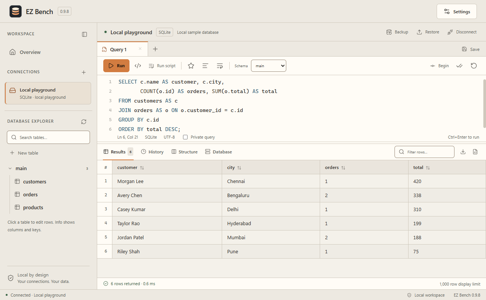

#  EZ Bench

EZ Bench is a Windows desktop SQL client for MySQL, MariaDB, PostgreSQL, SQL Server, and SQLite. It includes a SQL editor, editable tables, query history, snippets, and SSH tunnelling.

[](https://github.com/m-1310/ez-bench/actions/workflows/build.yml)

[▶ Run EZ Bench](#run-from-a-fresh-clone) · [↻ Update from Git](#update-a-git-installation) · [▣ Screenshots](#screenshots) · [✎ Contribute](#contributions-welcome)

## Screenshots

### Workspace overview


### SQL editor and results

The built-in SQLite playground runs this query against sample customer and order data.



## Run from a fresh clone

### Install from Git and add a desktop shortcut

Install [Git for Windows](https://git-scm.com/install/windows) and [Node.js 24 LTS](https://nodejs.org/en/download) for Windows x64. Open [PowerShell 7](https://learn.microsoft.com/powershell/scripting/install/install-powershell-on-windows) and run:

```powershell
$installDir = Join-Path $env:LOCALAPPDATA 'Programs\EZ Bench Source'
git clone https://github.com/m-1310/ez-bench.git $installDir
Set-Location $installDir
./scripts/Install-FromGit.ps1
```

Open **EZ Bench (Source)** from your desktop. The script installs the pinned dependencies and Electron runtime, then points the shortcut at your Git checkout. Use this route if Windows blocks the unsigned EZ Bench setup. Keep the checkout in place so the shortcut can find it.

If you already have a checkout in a folder you want to keep, run `./scripts/Install-FromGit.ps1` from that checkout instead.

### Update a Git installation

Save your SQL files and close EZ Bench. Open PowerShell 7 and run the following commands. If you cloned to a different folder, use that path on the first line.

```powershell
Set-Location -LiteralPath (Join-Path $env:LOCALAPPDATA 'Programs\EZ Bench Source') -ErrorAction Stop
git pull --ff-only
if ($LASTEXITCODE -ne 0) { throw 'Git could not update this checkout. Resolve the Git error before continuing.' }
./scripts/Install-FromGit.ps1
```

Open **EZ Bench (Source)** from your desktop again. The script refreshes the pinned dependencies and the existing shortcut. Your saved profiles and history are stored separately from the checkout.

In a Git installation, **Help > Check for updates** and **Settings > Check for updates** open the update dialog. Choose **View Git update instructions** to return to this guide.

### Launch from PowerShell

To run the app from a development checkout, open PowerShell and run:

```powershell
git clone https://github.com/m-1310/ez-bench.git
Set-Location ez-bench\app
npm.cmd ci
npm.cmd run setup
npm.cmd start
```

`npm.cmd ci` installs the pinned dependencies. `npm.cmd run setup` ensures Electron is available. On later launches, run `npm.cmd start` from `app` or `./scripts/Start-EZ-Bench.ps1` from the repository root.

To create a shortcut by hand after running `npm.cmd ci` and `npm.cmd run setup`, stay in the `app` folder and print the shortcut target:

```powershell
$appDir = (Get-Location).Path
'"{0}\node_modules\electron\dist\electron.exe" "{0}"' -f $appDir
```

On your desktop, right-click an empty area and choose **New > Shortcut**. Paste the printed line as the location and name it **EZ Bench (Source)**. To add the app icon, open the shortcut's **Properties > Change Icon** and select `icon.ico` from the `app` folder.

Choose **Open playground** to start with a local SQLite database. For a remote database, choose **New connection**, enter the host, port, and credentials, then select **Test connection**. Use the certificate hostname for MySQL or MariaDB when TLS is enabled. See the [user guide](app/README.md) for SSH and backup options.

## Test

From `app`, with dependencies and Electron installed, run:

```powershell
npm.cmd test
npm.cmd run test:ui
```

The test suites use isolated app data and local fixtures. They require no database account, signing key, or configured update feed. See the [0.9.8 verification report](docs/VERIFICATION-0.9.8.md) for engine coverage and remaining checks.

## Build on Windows

The repository contains source and assets. Follow the [build instructions](docs/RELEASING.md) to create a portable ZIP or Windows setup locally. Generated executables, vendor binaries, and release archives are kept out of Git.

## Contributions welcome

Bug reports, documentation improvements, fixes, and new features are welcome.

- **Repository owner and added collaborators with write access** can push directly to their feature branches in this repository.
- **Other contributors** can fork the repository and push to a feature branch in their fork.
- **Everyone** opens a pull request to change `main`. The branch blocks direct pushes, and the repository owner (`@m-1310`) reviews and merges the PRs.

1. Create a feature branch, for example `git switch -c docs/improve-setup`.
2. Make your change, run the relevant tests, and commit the files you intend to share.
3. Push your branch, for example `git push -u origin docs/improve-setup`. If you forked the project, push to your fork.
4. Open a PR targeting `m-1310/ez-bench:main`. Explain what changed and how you tested it.

Keep connection profiles, private keys, environment files, generated executables, and database exports local. See [security and privacy](SECURITY.md).

EZ Bench is [MIT licensed](LICENSE). Dependency and icon notices are included with the app.
