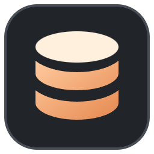
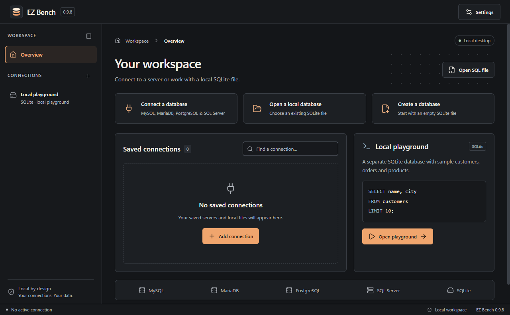

#  EZ Bench

EZ Bench is a Windows desktop SQL client for MySQL, MariaDB, PostgreSQL, SQL Server, and SQLite. It includes a SQL editor, editable tables, query history, snippets, and SSH tunnelling.

[](https://github.com/m-1310/ez-bench/actions/workflows/build.yml)

[▶ Run EZ Bench](#run-from-a-fresh-clone) · [▣ Screenshots](#screenshots) · [✎ Contribute](#contributions-welcome)

## Screenshots

### Workspace overview



### SQL editor and results

The built-in SQLite playground runs this query against sample customer and order data.


## Run from a fresh clone

Install [Node.js 24 LTS](https://nodejs.org/en/download) for Windows x64. Open PowerShell and run:

```powershell
git clone https://github.com/m-1310/ez-bench.git
Set-Location ez-bench\app
npm.cmd ci
npm.cmd run setup
npm.cmd start
```

`npm.cmd ci` installs the pinned dependencies. `npm.cmd run setup` ensures Electron is available. On later launches, run `npm.cmd start` from `app` or `./scripts/Start-EZ-Bench.ps1` from the repository root.

Choose **Open playground** to start with a local SQLite database. For a remote database, choose **New connection**, enter the host, port, and credentials, then select **Test connection**. Use the certificate hostname for MySQL or MariaDB when TLS is enabled. See the [user guide](app/README.md) for SSH and backup options.

## Test

From `app`, with dependencies and Electron installed, run:

```powershell
npm.cmd test
npm.cmd run test:ui
```

The test suites use isolated app data and local fixtures. They require no database account, signing key, or configured update feed. See the [0.9.8 verification report](docs/VERIFICATION-0.9.8.md) for engine coverage and remaining checks.

## Build on Windows

The repository contains source and assets. Follow the [build instructions](docs/RELEASING.md) to create a portable ZIP or Windows setup locally. Generated executables, vendor binaries, and release archives are kept out of Git.

## Contributions welcome

Bug reports, documentation improvements, fixes, and new features are welcome.

- **Repository owner and added collaborators with write access** can push directly to their feature branches in this repository.
- **Other contributors** can fork the repository and push to a feature branch in their fork.
- **Everyone** opens a pull request to change `main`. The branch blocks direct pushes, and the repository owner (`@m-1310`) reviews and merges the PRs.

1. Create a feature branch, for example `git switch -c docs/improve-setup`.
2. Make your change, run the relevant tests, and commit the files you intend to share.
3. Push your branch, for example `git push -u origin docs/improve-setup`. If you forked the project, push to your fork.
4. Open a PR targeting `m-1310/ez-bench:main`. Explain what changed and how you tested it.

Keep connection profiles, private keys, environment files, generated executables, and database exports local. See [security and privacy](SECURITY.md).

EZ Bench is [MIT licensed](LICENSE). Dependency and icon notices are included with the app.
